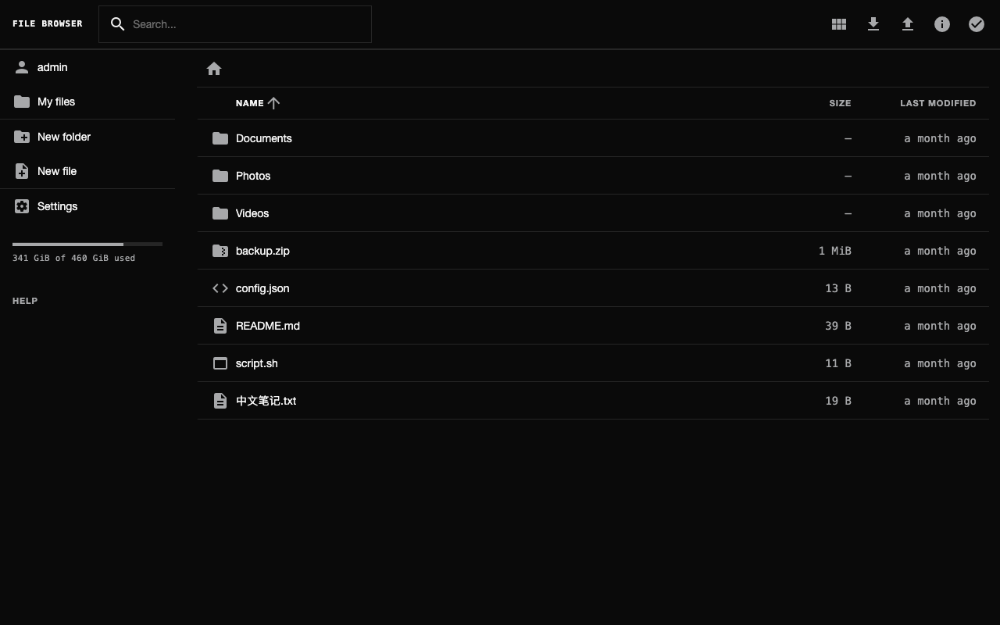
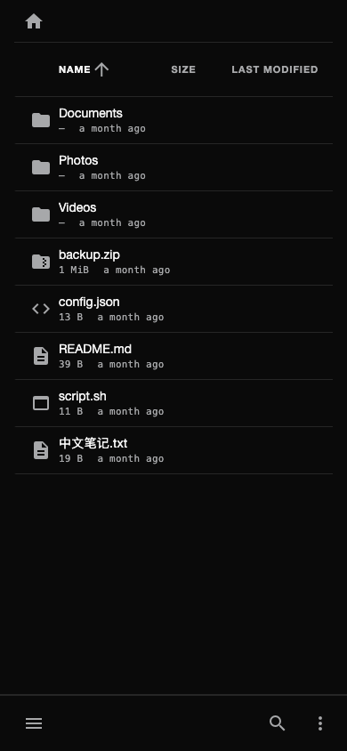
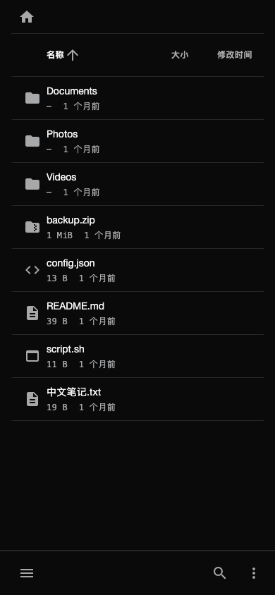
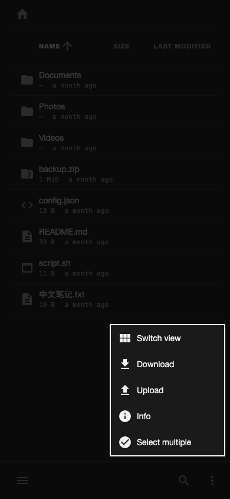
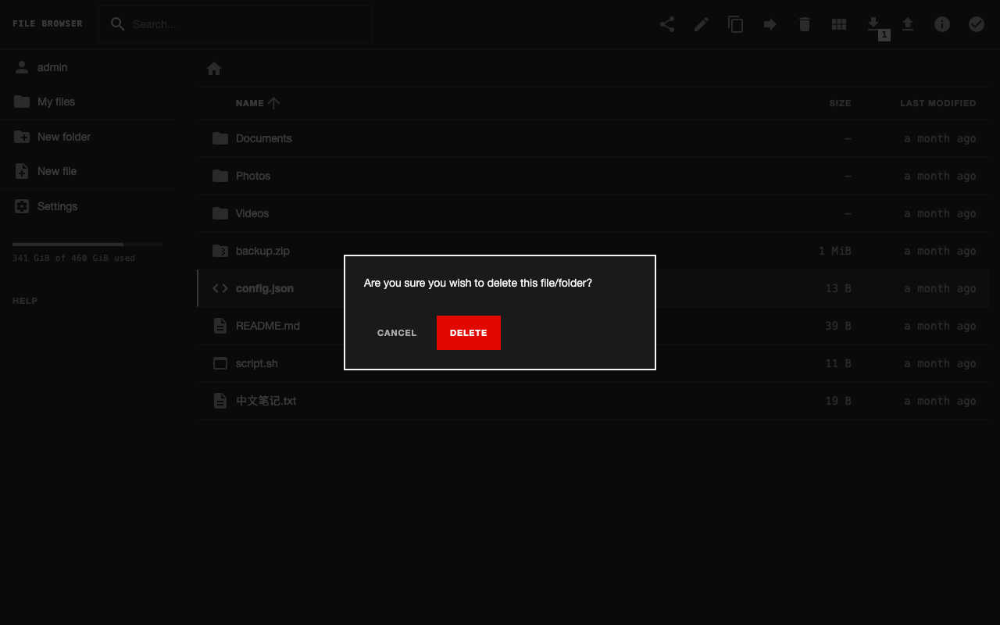
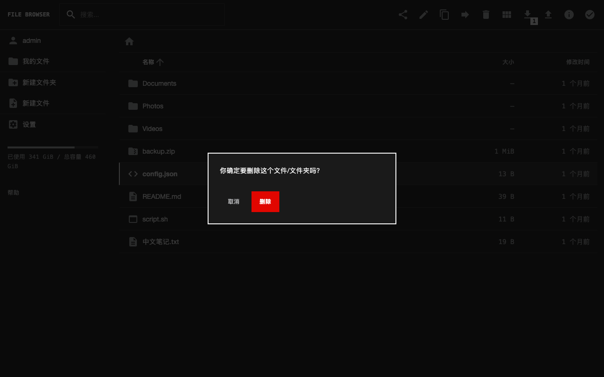
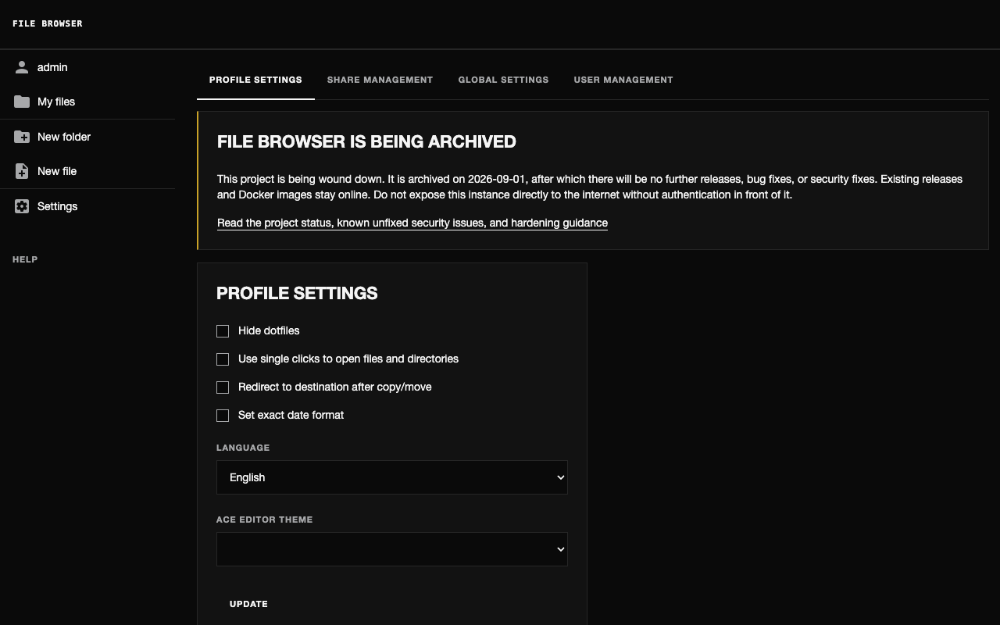

# Boring Box theme for File Browser

A drop-in `custom.css` that gives [File Browser](https://github.com/filebrowser/filebrowser) the
Boring Box look: an ink-only palette, flat and square, the Helvetica / PingFang type stack on a 4px grid,
two weights, and the single red signal used only for destructive actions and a dialog's primary button.
It works in English and Chinese.

It is pure CSS. It changes no File Browser behaviour, and every feature (upload incl. drag-drop,
download, move/copy/rename/delete, preview, search, shares, settings) works as before.



| Phone listing | Phone, Chinese UI | Phone "more" menu (thumb reach) |
|---|---|---|
|  |  |  |

| Delete confirm | Delete confirm, Chinese UI | Settings |
|---|---|---|
|  |  |  |

## Requirements

File Browser **built from the `themeable` branch** (v2.63.23 + two commits): it adds the theme variables
this file overrides (`--radius-*`, `--shadow-*`, `--font-ui`, `--accent*`, `--header-height`, …) and the
`branding.disableCredits` option. On a stock v2.63.23 most of the look still applies, but radii, shadows,
the font and the accent stay stock, and `--branding.disableCredits` is an unknown flag.

## Install: three flags and one folder

1. Put this folder (at least `custom.css`) somewhere File Browser can read, e.g. `/srv/filebrowser/theme`.
2. Stop File Browser and apply the settings (the `--branding.*` options live on `config set`, not on the
   run command):

   ```sh
   filebrowser -d /path/to/filebrowser.db config set \
     --branding.files /srv/filebrowser/theme \
     --branding.theme dark \
     --branding.disableCredits \
     --branding.disableExternal \
     --viewMode list
   ```

   - `--branding.files` loads `custom.css`.
   - `--branding.theme dark` is the default theme (the theme renders light and dark the same anyway).
   - `--branding.disableCredits` hides the "File Browser <version>" line, and
     `--branding.disableExternal` removes the GitHub links.
   - `--viewMode list` is the default for **new** users. Existing users keep their view; switch them with
     `filebrowser -d … users update <name> --viewMode list`, or use the view toggle in the header.
3. Start File Browser as usual and hard-reload the browser.

The same options are under **Settings → Global Settings → Branding**, for admins.

### Options inside the CSS

- `--bb-app-name` (top of section 1): the micro-label shown in the header in place of the logo. Default
  `"File Browser"`.

## How it is built

`custom.css` = `static/css/tokens.css` (verbatim, the only place a value is written) + `src/theme.css`
(tokens + File Browser variables + ordinary selectors, no literals). To rebuild:

```sh
cat ../static/css/tokens.css src/theme.css > custom.css
```

On phones (≤ 736px, File Browser's own breakpoint), the header moves to the bottom of the screen, so the
menu, search and the "more" menu (with Upload) are all in thumb reach. Rows become stacked records with
the name on top and the size and date below.

## Checked against `DESIGN_RULES.md`

Five screens (listing, folder, upload dialog, delete confirm, settings) at 1280×800 and 390×844, in
English and Chinese. An automated audit of the rendered DOM found **0** non-zero radii, 0 shadows, 0
weights outside 400/700, 0 text sizes off the type scale, 0 colours outside the tokens, and no horizontal
scroll at 390px. Every tap target is at least 44px, except the settings checkboxes (below).

### Rules not (fully) met, and why

| Rule | Gap | Why |
|---|---|---|
| R-01 px only / R-02 spacing scale | File Browser's own layout still uses `em`/`rem` (sidebar width, main column, some card and row paddings), so some intervals fall off the 4px scale. | Fixing every one means rewriting the app's stylesheets, which is a fork. The theme puts everything visible (type, rows, header, dialogs, controls) on tokens. |
| R-04 grid | No 12/8/4-column grid; the layout is File Browser's sidebar + main column. | Layout structure lives in the app. |
| R-16 breakpoints | The phone layout switches at **736px**, not 768px; the app keeps its own 1024/1200/450px rules. | File Browser decides "mobile" in JavaScript at ≤736px (which actions appear where); a CSS breakpoint at 768 would mismatch it between 737 and 767px. |
| R-18 one source | One literal: the `736px` in the media query. Inline colours from the disk-usage bar component are overridden with `!important`. | CSS cannot use `var()` in a media query; the bar sets inline styles. |
| R-14 / R-16 touch targets | Settings checkboxes are 16px. | Upstream markup doesn't wrap them in a `<label>`, so the text isn't clickable and CSS can't enlarge the hit area cleanly. |
| R-14 hover in `(hover: hover)` | Some app-defined hovers (folder picker, settings tabs) are not media-guarded. | The theme neutralises the main ones; the rest are minor. |
| R-08 mixed strings | A Chinese filename in an English UI is set at the Latin leading (14/20), not 14/24. | No `.cjk` hook can be added to app markup from CSS. Whole-page Chinese (`html:lang(zh)`) is handled by the tokens. |
| R-05 type roles | Material Icons glyphs stay at 24px and are drawn with rounded strokes. | They are glyphs, not text; replacing the icon font is out of scope. |
| R-12 flat | Native `<select>` option lists and the dropdown arrow are drawn by the OS. | Not stylable from CSS. |
| R-13 flush left | A few centred texts remain on screens not audited (login/share error banners, previewer info). | Not in the audited five screens; low traffic. |
| R-19 / R-23 the mark | The header shows a text micro-label, not the Boring Box mark. | As specified for this app. The mark could ship as `img/logo.svg` in this folder later. |

Not audited: login page (`--noauth` here), public share page, text editor, media previewer. All of them
are themed by the same variables and selectors, but they weren't checked screen by screen.
